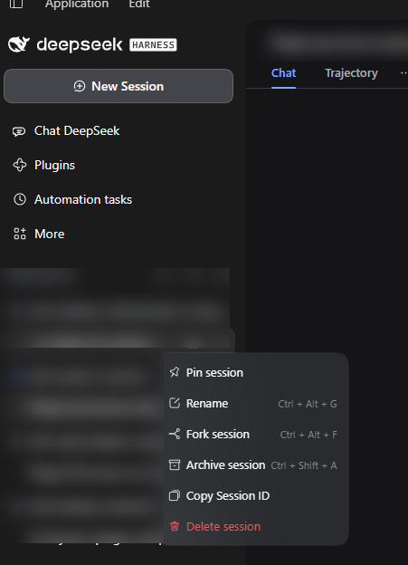
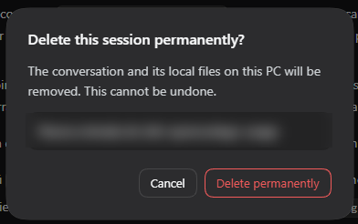

# dsh-session-remover

[](https://www.npmjs.com/package/@jamolpe88/dsh-session-remover)
[](https://github.com/JaMoLpE88/dsh-session-remover/releases)
[](LICENSE)
[](#compatibilidad)
[](#compatibilidad)
[](https://dsh-plugin.org/plugins/jamolpe88/dsh-session-remover)

**Borra una sesión de DeepSeek Harness para siempre, desde su propio menú `⋯`.** Una fila en rojo, una confirmación, y la conversación desaparece de DSH *y* del disco: su log JSONL, su caché de proyecciones y su sitio en el registro de workspaces.

Sin página de ajustes, sin gestor de archivados, sin herramientas para el agente. Interfaz sólo en inglés. Nada más.

**English** → [README.md](README.md)



*El menú `⋯` de una sesión: **Delete session** aparece en rojo, después de las filas nativas (fijar, renombrar, bifurcar, archivar, copiar ID). Los nombres de workspace y de sesión están difuminados.*



*La confirmación: la sesión que se va a borrar aparece nombrada en el diálogo (aquí difuminada), **Cancel** tiene el foco inicial y no se envía nada al Host hasta que confirmas.*

## Qué hace

- Añade **Delete session** al menú `⋯` de cada sesión, en rojo y después de las filas nativas.
- Abre una confirmación con el estilo de DSH que nombra la sesión exacta; **Cancel** recibe el foco y **Escape** cierra el diálogo sin hacer nada.
- Cierra la sesión antes de tocar el almacenamiento. Si está abierta, ejecuta el mismo desmontaje ordenado que DSH usa con sus agentes (parar, drenar, liberar el escritor, desacoplar) y espera a que termine.
- Elimina la carpeta propia de la sesión `<almacén de sesiones>/<proyecto>/<id-de-sesión>/`, incluido su log `.v4.jsonl.zstd`.
- Elimina el registro derivado `storages/session_projcache/sessions/<id-de-sesión>.json`, para que no quede ni el título ni el texto de los mensajes en caché.
- Limpia el registro de workspaces: desasocia la sesión de todos los workspaces que la listaban, la despina y borra su marca de archivado.
- Refresca el sidebar y, si la sesión borrada era la que estabas viendo, vacía el panel principal.

## Qué no hace

- **No borra los adjuntos.** Las imágenes y ficheros viven en un almacén compartido por contenido (`attachments/v1/objects/<hash>`) que otras sesiones pueden referenciar, así que no se tocan. Ver [Qué queda en disco](#qué-queda-en-disco).
- No toca otras sesiones, los ficheros de tu workspace, los logs de DSH, tus copias de seguridad ni ninguna copia en la nube.
- No añade página de ajustes, navegador de archivados ni búsqueda de historial.
- No añade herramientas ni comandos para el agente: el borrado es sólo del usuario y se confirma en la interfaz.
- No hace ninguna petición de red.

## Por qué no hay ajustes

La única decisión es qué sesión borrar, y eso ya es un argumento de la acción. No hay umbral que calibrar, ni intervalo, ni clave, ni alcance. Una página de configuración sería un segundo sitio donde explicar el mismo comportamiento.

## Requisitos

- **DSH Desktop** `>= 0.2.1-rc.3`, perfil `desktop` (probado en `0.2.1-rc.3`, Windows 11).
- El almacén de sesiones **JSONL** por sesión, el de serie. Cualquier otro backend se rechaza al cargar.
- Node 22+ (DSH lleva su propio runtime).
- **Un reinicio después de instalar o actualizar.** La mitad Host intercepta el ciclo de vida de los agentes, así que sólo puede cerrar sesiones abiertas *después* de cargarse. Las anteriores se rechazan, no se borran a medias.

## Instalación

Desde npm:

```bash
dsh plugin --profile desktop add @jamolpe88/dsh-session-remover
```

Desde el repositorio:

```bash
dsh plugin --profile desktop add github:JaMoLpE88/dsh-session-remover
```

Desde un checkout local, mientras desarrollas:

```bash
dsh plugin --profile desktop add C:\ruta\a\dsh-session-remover
```

Cierra DSH del todo y vuelve a abrirlo después de instalar, y luego refresca la ventana.

## Uso

1. Pasa el ratón por una sesión del sidebar y abre su menú `⋯`.
2. Elige **Delete session** (rojo, última fila).
3. Comprueba el nombre de la sesión en el diálogo y confirma con **Delete permanently**, o cancela.

Una sesión archivada no tiene fila en el sidebar: desarchívala primero desde la página de archivados nativa de DSH y bórrala después desde su menú. El borrado limpia la marca de archivado y el pin por el camino, así que no queda nada obsoleto en el registro.

## Qué se borra

| Ruta | Qué es |
|---|---|
| `<almacén de sesiones>/<proyecto>/<id-de-sesión>/` | La carpeta propia de la sesión: su log versionado `.jsonl.zstd` y lo que haya junto a él |
| `storages/session_projcache/sessions/<id-de-sesión>.json` | Proyecciones en caché: título y valores derivados de los mensajes |
| `storages/workspace.json` | Sólo las referencias: la sesión se desasocia, se despina y se desarchiva |

Nada más se elimina. La sesión no va a la Papelera de reciclaje: los ficheros se borran, así que el espacio se libera en el momento.

## Qué queda en disco

**Los adjuntos.** Las imágenes y ficheros se guardan una vez por hash de contenido en `attachments/v1/objects/`. Una sesión bifurcada hereda referencias a los mismos hashes, así que borrar los objetos rompería las imágenes del fork. DSH no lleva contador de referencias, y el plugin prefiere no adivinar.

En una conversación sólo de texto no queda nada. Si el objetivo es recuperar espacio, las imágenes son lo que más pesa: esa limpieza exige recorrer los logs restantes y queda deliberadamente fuera de alcance por ahora.

Tampoco se tocan: los logs de DSH, los ficheros de tu workspace, las copias que hayas hecho tú y cualquier copia que ya haya salido de la máquina.

## Cómo funciona

La mitad **Host** registra una sola ruta, `POST /plugins/session-remover/delete`:

1. La petición debe pasar el filtro propio del Host y llevar la cabecera `x-session-remover-confirmation: delete-session`. Un enlace, un formulario HTML o una petición de otro sitio no pueden generar esa cabecera.
2. El id de sesión se valida (`^[A-Za-z0-9][A-Za-z0-9_-]{0,127}$`) antes de poder nombrar una ruta.
3. Un agente vivo se cierra a través del `AgentHandle` que devolvieron `ctx.agents.create`/`resume`. DSH no expone un dispose en el registro, así que el plugin guarda esos handles según se crean y se niega a borrar cuando no tiene uno.
4. La carpeta se resuelve con `sessionPersistence.stat` + `locate` y se contrasta recorriendo la raíz del almacén; después debe ser exactamente `<raíz>/<un segmento de proyecto>/<id de sesión>`, una carpeta real y contener un log de sesión.
5. Se limpian las referencias del workspace, se elimina la carpeta y se borra el registro de caché de proyecciones por la API de su tabla (o por su fichero, cuando no hay API).
6. Una búsqueda barata reconcilia el índice SQLite, que si no sólo descarta sesiones borradas en su siguiente búsqueda. Todo lo posterior a la comprobación de la carpeta es best-effort y se reporta, nunca se da por hecho.

La mitad **Client** es un `client.js` plano sin build: registra una fila en `sidebar.workspaces.session.menu.item` y un diálogo en `shell.overlay`, sólo requiere `react` y usa tokens `--dsw-alias-*`. No carga paquetes de cliente del Harness, así que una actualización de DSH que renombre una primitiva no puede dejar la entrada en blanco.

## Compatibilidad

| | |
|---|---|
| DSH | `>= 0.2.1-rc.3` (probado en `0.2.1-rc.3`) |
| Node | `>= 22` |
| SO | Windows 11 (probado); macOS y Linux sin probar |
| Perfil | `desktop` (probado); `web` sin probar |
| Almacén | backend JSONL por sesión (el de serie) |
| Catálogo | [listado en dsh-plugin.org](https://dsh-plugin.org/plugins/jamolpe88/dsh-session-remover) |

Estado de validación: **probado en Windows 11 con DSH Desktop 0.2.1-rc.3** (2026-10-26). La fila del menú y la confirmación se usaron a través de la interfaz; se borró una sesión real (un fork) y se verificó que desaparecían su carpeta, su registro de caché y sus referencias en el workspace, dejando intacta otra sesión vecina.

Sin validar: macOS, Linux, el perfil web y otras versiones de DSH.

## Límites

- **Sólo se prueba una versión de DSH.** El borrado depende del formato en disco del almacén JSONL y del `AgentHandle` que devuelve el registro de agentes; una versión futura puede cambiar cualquiera de los dos.
- **Las sesiones abiertas antes de cargar el plugin no se pueden cerrar.** Reinicia DSH una vez tras instalar o actualizar.
- **Un almacén corrupto o inesperado se rechaza, no se fuerza.** Carpetas con symlink, una carpeta de sesión sin log, o la misma sesión en dos proyectos terminan en error y en cero borrados.
- **Las sesiones archivadas** hay que desarchivarlas antes, porque DSH no les da fila en el sidebar.
- **Los adjuntos se conservan** (ver arriba).
- **Un borrado a la vez por sesión.** Una segunda petición mientras corre la primera se rechaza.

## Privacidad

- Sin acceso a red, sin telemetría, sin servicios externos.
- No lee cookies, tokens ni credenciales.
- El diálogo de confirmación sólo envía el id de la sesión.
- El texto de la interfaz está sólo en inglés, por diseño.
- Las capturas están tomadas de una sesión real; los nombres de workspace y de sesión están difuminados.

## Problemas

| Mensaje | Significado |
|---|---|
| `This session was opened before Session Remover was loaded…` | El agente existía antes de cargar el plugin. Reinicia DSH y reinténtalo; no se borró nada. |
| `DeepSeek Harness did not finish closing this session; nothing was deleted.` | El desmontaje no terminó a tiempo. Reinténtalo; no se borró nada. |
| `The session directory does not contain a session log; nothing was deleted.` | Esa carpeta no parece el almacén de esta sesión. No se borró nada. |
| `This session matches more than one storage directory; nothing was deleted.` | El mismo id existe en dos proyectos. Resuélvelo a mano; no se borró nada. |
| `The session files could not be removed (…)` | El sistema operativo rechazó el borrado; el diálogo muestra el código. |
| `The delete request did not pass the origin and confirmation checks.` | La petición no venía de la ventana de la app. Recarga DSH. |

Cuando algo falla la regla es la misma: **no se borra nada hasta que toda la ruta validada sale bien**, y el error lo dice.

## Desarrollo

```bash
npm run check   # comprobación de sintaxis y el self-check de validación de rutas
npm test        # borrado Host de extremo a extremo sobre un árbol temporal
```

`check.mjs` cubre las reglas de contención (ids inválidos, `..`, profundidad incorrecta, carpetas ajenas). `test-host.mjs` ejecuta el handler real con servicios del Harness simulados: filtro de petición, id inválido, borrado en frío con una sesión vecina que sobrevive, cierre del agente vivo, el respaldo del fichero de caché y la negativa a tratar una carpeta sin log como almacén.

Instalación local:

```bash
dsh plugin --profile desktop add C:\ruta\a\dsh-session-remover
```

Sin paso de build: `client.js` es el artefacto que se publica.

## Licencia

[MIT](LICENSE) © 2026 JaMoLpE88
