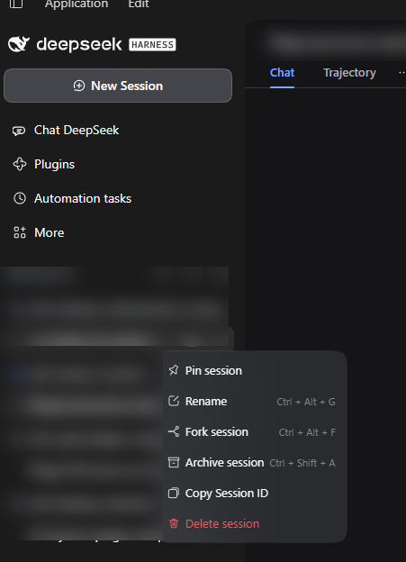
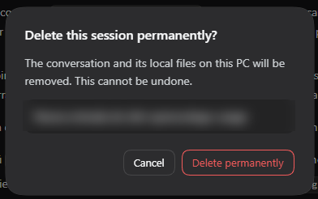

# dsh-session-remover

[](https://www.npmjs.com/package/@jamolpe88/dsh-session-remover)
[](https://github.com/JaMoLpE88/dsh-session-remover/releases)
[](LICENSE)
[](#compatibility)
[](#compatibility)
[](https://dsh-plugin.org/plugins/jamolpe88/dsh-session-remover)

**Delete a DeepSeek Harness session for good, straight from its `⋯` menu.** One red row, one confirmation, and the conversation is gone from DSH *and* from the disk: its JSONL log, its projection cache and its place in the workspace registry.

No settings page, no archive manager, no agent tools. English-only interface. Nothing else is added.

**Español** → [README.es.md](README.es.md)



*The session `⋯` menu: **Delete session** sits in red after the shipped rows (pin, rename, fork, archive, copy Session ID). Workspace and session names are blurred.*



*The confirmation: the session to delete is named in the dialog (blurred here), **Cancel** has the initial focus, and nothing is sent to the Host until you confirm.*

## What it does

- Adds **Delete session** to the `⋯` menu of every session row, in red, ordered after the shipped rows.
- Opens a DSH-styled confirmation that names the exact session; **Cancel** takes the initial focus and **Escape** closes the dialog without doing anything.
- Closes the session before touching storage. If it is open, the plugin runs the same ordered teardown DSH uses for its own agents (stop, drain, release the writer, detach) and waits for it to finish.
- Removes the session's own directory `<session store>/<project>/<session-id>/`, including its `.v4.jsonl.zstd` log.
- Removes the derived cache record `storages/session_projcache/sessions/<session-id>.json`, so no cached title or message text survives.
- Cleans the workspace registry: detaches the session from every workspace that lists it, unpins it and clears its archive marker.
- Refreshes the sidebar, and clears the main panel if the deleted session was the one on screen.

## What it does not do

- **Does not delete attachments.** Images and files live in a content-addressed shared store (`attachments/v1/objects/<hash>`) that other sessions may reference, so they are left alone. See [What stays on disk](#what-stays-on-disk).
- Does not touch other sessions, the files of your workspace, DSH logs, backups or any cloud copy.
- Does not add a settings page, an archive browser or a history search.
- Does not add an agent tool or a slash command: deletion is user-only and confirmed in the UI.
- Does not make any network request.

## Why there are no settings

The only decision is which session to delete, and that is already an argument of the action. There is no threshold to tune, no interval, no key, no scope. A config page would be a second place to explain the same single behaviour.

## Requirements

- **DSH Desktop** `>= 0.2.1-rc.3`, profile `desktop` (tested on `0.2.1-rc.3`, Windows 11).
- The default per-session **JSONL** session store. A non-JSONL backend is refused at load time.
- Node 22+ (DSH ships its own runtime).
- **One restart after installing or updating the plugin.** The Host half intercepts the agent lifecycle, so it can only close sessions that were opened *after* it loaded. Sessions opened before that are refused, not half-deleted.

## Install

From npm:

```bash
dsh plugin --profile desktop add @jamolpe88/dsh-session-remover
```

From the repository:

```bash
dsh plugin --profile desktop add github:JaMoLpE88/dsh-session-remover
```

From a local checkout, while developing:

```bash
dsh plugin --profile desktop add C:\path\to\dsh-session-remover
```

Fully quit and reopen DSH after installing, then refresh the window.

## Usage

1. Hover a session in the sidebar and open its `⋯` menu.
2. Choose **Delete session** (red, last row).
3. Check the session name in the dialog and confirm with **Delete permanently**, or cancel.

An archived session has no sidebar row: unarchive it first from DSH's own archive page, then delete it from its menu. Deletion clears the archive marker and the pin on the way out, so nothing stale is left in the registry.

## What gets deleted

| Path | What it is |
|---|---|
| `<session store>/<project>/<session-id>/` | The session's own directory: its versioned `.jsonl.zstd` log and anything beside it |
| `storages/session_projcache/sessions/<session-id>.json` | Cached projections: title, message-derived values |
| `storages/workspace.json` | Only the references: the session is detached, unpinned and unarchived |

Nothing else is removed. The session is not moved to a recycle bin: the files are deleted, so the space is returned immediately.

## What stays on disk

**Attachments.** Images and files are stored once per content hash under `attachments/v1/objects/`. A forked session inherits references to the same hashes, so deleting the objects would break the fork's images. DSH keeps no reference count, so the plugin leaves them alone rather than guessing.

For a text-only conversation this is nothing at all. If your goal is reclaiming disk space, images are what dominates — that cleanup needs a scan of the remaining logs and is deliberately out of scope for now.

Also untouched: DSH's own logs, your workspace files, backups you made yourself and any copy that already left the machine.

## How it works

The **Host** half registers one route, `POST /plugins/session-remover/delete`:

1. The request must pass the Host's own request fence and carry the `x-session-remover-confirmation: delete-session` header. A link, an HTML form or a cross-site request cannot produce that header.
2. The session id is validated (`^[A-Za-z0-9][A-Za-z0-9_-]{0,127}$`) before it can name a path.
3. A live agent is closed through the `AgentHandle` that `ctx.agents.create`/`resume` returned. DSH exposes no dispose on the registry itself, so the plugin keeps those handles as they are created and refuses to delete when it has none.
4. The storage directory is resolved from `sessionPersistence.stat` + `locate` and cross-checked by scanning the store root, then required to be exactly `<root>/<one project segment>/<session id>`, a real directory, containing a session log file.
5. Workspace references are cleaned, the directory is removed, and the projection-cache record is dropped through its table API (or its file, when the API is absent).
6. A cheap search reconciles the SQLite search index, which otherwise only drops removed sessions on its next search. Every step after the directory check is best-effort and reported, never assumed.

The **Client** half is one plain `client.js` with no build step: it registers a row in `sidebar.workspaces.session.menu.item` and a dialog in `shell.overlay`, requires only `react`, and styles with `--dsw-alias-*` tokens. It does not load Harness Client packages, so a DSH update that renames a primitive cannot blank the entry.

## Compatibility

| | |
|---|---|
| DSH | `>= 0.2.1-rc.3` (tested on `0.2.1-rc.3`) |
| Node | `>= 22` |
| OS | Windows 11 (tested); macOS and Linux untested |
| Profile | `desktop` (tested); `web` untested |
| Session store | per-session JSONL backend (the default) |
| Catalog | [listed on dsh-plugin.org](https://dsh-plugin.org/plugins/jamolpe88/dsh-session-remover) |

Validation status: **tested on Windows 11 with DSH Desktop 0.2.1-rc.3** (2026-10-26). The menu row and the confirmation were used through the interface; a real session (a fork) was deleted and its directory, its projection-cache record and its workspace references were verified gone afterwards, with a sibling session left intact.

Not validated: macOS, Linux, the web profile and other DSH versions.

## Limits

- **One DSH version is tested.** The deletion path depends on the JSONL store's on-disk layout and on the `AgentHandle` returned by the agent registry; a future DSH release may change either.
- **Sessions opened before the plugin loaded cannot be closed.** Restart DSH once after installing or updating.
- **A corrupt or unexpected store is refused, not forced.** Symlinked directories, a session directory without a log file, or an ambiguous match in two project directories end in an error and no deletion.
- **Archived sessions** need unarchiving first, because DSH gives them no sidebar row.
- **Attachments are kept** (see above).
- **One deletion at a time per session.** A second request while the first is running is rejected.

## Privacy

- No network access, no telemetry, no external service.
- No cookies, no tokens, no credentials read.
- The confirmation dialog sends only the session id.
- The interface text is English only, by design.
- The screenshots above come from a real session; workspace and session names are blurred.

## Troubleshooting

| Message | Meaning |
|---|---|
| `This session was opened before Session Remover was loaded…` | The agent existed before the plugin loaded. Restart DSH and try again; nothing was deleted. |
| `DeepSeek Harness did not finish closing this session; nothing was deleted.` | The teardown did not settle in time. Retry; nothing was deleted. |
| `The session directory does not contain a session log; nothing was deleted.` | The directory does not look like this session's storage. Nothing was deleted. |
| `This session matches more than one storage directory; nothing was deleted.` | The same id exists in two project directories. Resolve it by hand; nothing was deleted. |
| `The session files could not be removed (…)` | The operating system refused the removal; the dialog reports the code. |
| `The delete request did not pass the origin and confirmation checks.` | The request did not come from the app window. Reload DSH. |

When something fails, the rule is the same: **nothing is deleted unless the whole validated path succeeds**, and the error says so.

## Development

```bash
npm run check   # syntax checks plus the path-validation self-check
npm test        # end-to-end Host deletion against a throwaway tree
```

`check.mjs` covers the containment rules (invalid ids, `..`, wrong depth, foreign directories) and that the Client module id, the package name and the patch row agree — a mismatch crashes web boot. `test-host.mjs` drives the real handler with stubbed Harness services: request gating, invalid id, cold deletion with a surviving sibling, live-agent teardown, the cache-file fallback and the refusal to treat a log-less directory as storage.

Local install:

```bash
dsh plugin --profile desktop add C:\path\to\dsh-session-remover
```

No build step: `client.js` is the shipped artifact.

## License

[MIT](LICENSE) © 2026 JaMoLpE88
